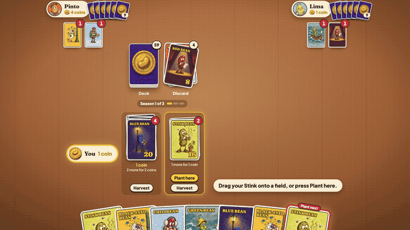
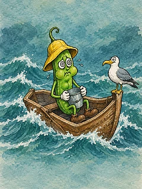
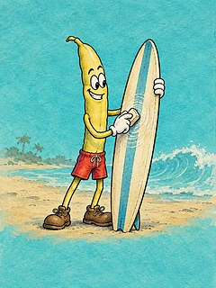

<div align="center">

# Bean Bazaar

**Adorable beans. Ruthless trading.**

A bean-trading card game for 1 player against 2 to 4 bots, right in your browser.

[](https://bean-bazaar.calvinphuah.com)

### [▶ Play free in your browser](https://bean-bazaar.calvinphuah.com) · [🎬 Watch the trailer](#watch-the-trailer)

No download, no sign-up. Your game saves in the browser, so a reload picks it up where you left it.

</div>

## Watch the trailer

https://github.com/user-attachments/assets/26a68a9e-3174-4e5e-a48a-ec110c18f053

## Meet the beans

<p align="center">
  
  
  
  
  
  <br>
  
  
  
  
  
</p>

Ten beans, each with its own character, from the Blue Bean playing sax in the rain to the Chili Bean bundled up against the snow.

## How it plays


- **Plant** the front card of your hand every turn, and the next one if you like. You can never reorder your hand.
- **Trade** the two cards you flip, or cards from your hand, with the bots. Whatever you get must be planted.
- **Harvest** a field for coins. Each field grows one bean type, and bigger piles pay more.
- **Win** with the most coins when the deck runs out for the third time.

Press **Rules** in the game for a guided tour of every rule.

## The bots

Four bots sit at the table, each with their own way of trading:

| Bot | Says no with | Plays |
| --- | --- | --- |
| Pinto | "Sorry, friend" | Generous: happy to give and take gifts |
| Lima | "Do better" | Shrewd: won't feed whoever is winning |
| Fava | "Mine, all mine" | Collector: guards the bean of its biggest field |
| Mung | "Not worth the risk" | Gambler: digs up fields to chase a new bean |

Bots come in three levels: Easy, Normal and Smart. Games with 4 bots add the Coffee and Golden beans.

---

## For developers

The game rules and the bots run in your browser, with no server.

### Running it locally

You need Node 22.

```bash
npm ci
```

```bash
npm run dev
```

Then open http://localhost:5173.

### How it's built

- `src/engine`: the game rules and bots in plain TypeScript, with no Vue or browser code.
- `src/games`: starting games, checking your moves, undo and trade quotes, on top of the engine.
- `src/api.ts`: the calls the Vue app makes; they run the engine and save the game in `localStorage`.
- `src/components`: the Vue 3 app, built with Vite.
- `scripts/balance.sim.ts`: plays thousands of games with a scripted player to check how often each bot level loses.
- `trailer/`: the launch trailer, built in Remotion. See [trailer/README.md](trailer/README.md).

### Checks

```bash
npm run typecheck && npm run lint && npm test && npm run build
```

Bot balance (takes a few minutes):

```bash
npm run sim
```

Set `SIM_GAMES`, `SIM_LEVELS` (`easy normal smart`) or `SIM_MODES` (`notrade pro allbots smartbot`) to change what it plays.

### Deploying

The site is static files, so any static host works. See [docs/cloudflare-pages.md](docs/cloudflare-pages.md) for Cloudflare Pages on your own subdomain.

## Credits

- Sound effects: "Casino Audio" by [Kenney](https://www.kenney.nl), CC0.
- Card and character art: AI-generated for this game.
- Trailer music and sound: see [trailer/public/audio/CREDITS.txt](trailer/public/audio/CREDITS.txt).
